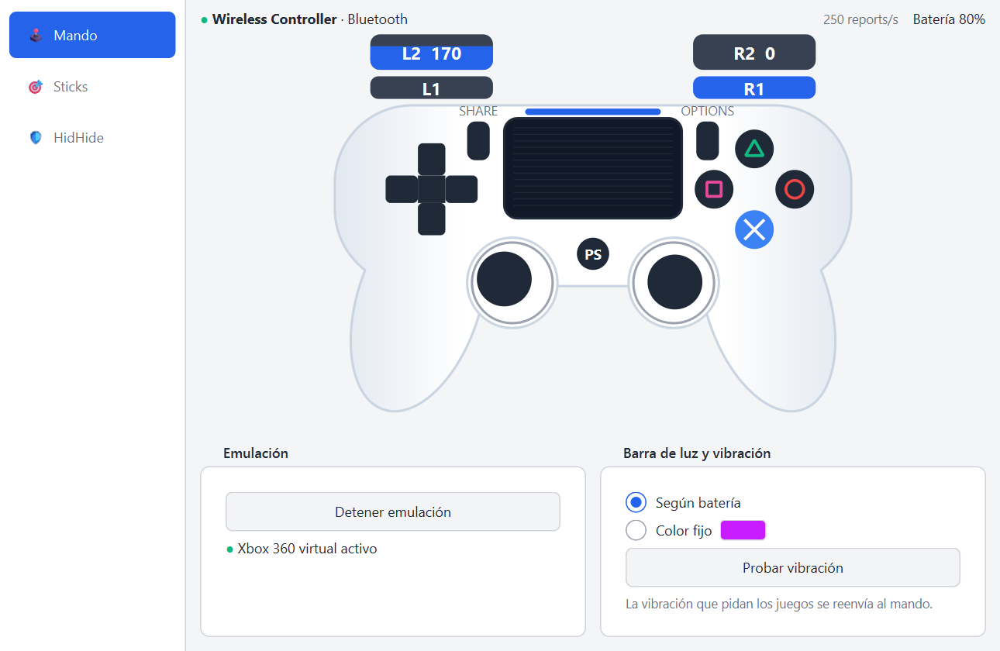
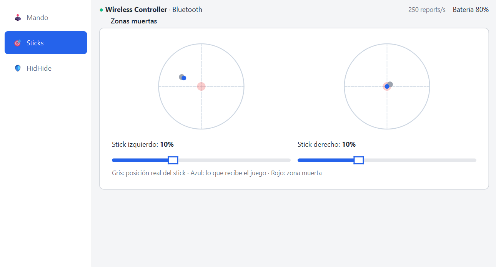
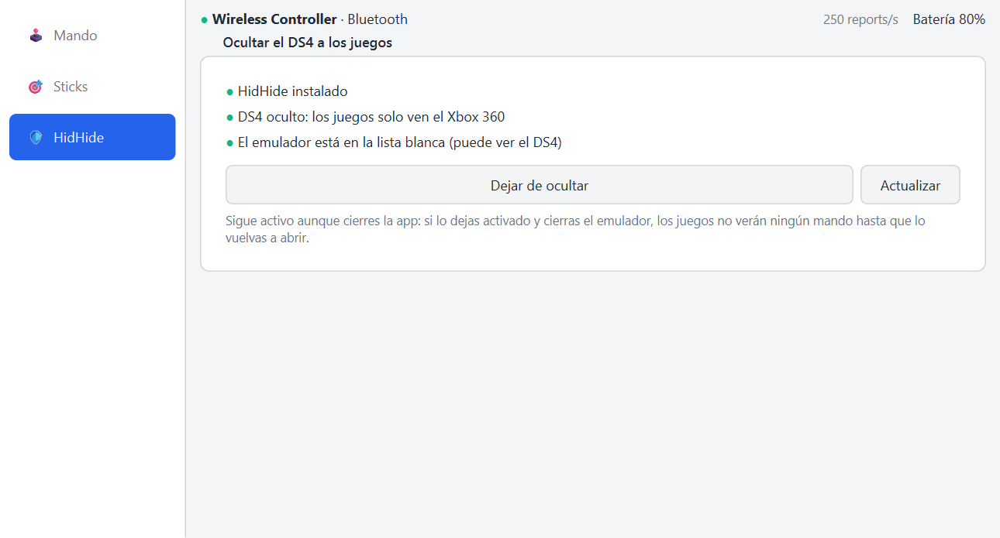

# DS4 → Xbox 360

Emulador para Windows que convierte un **DualShock 4** conectado por Bluetooth en
un **mando de Xbox 360 virtual**, para jugar con él a cualquier juego que acepte
mandos de Xbox.

Hecho en Python con PySide6 (interfaz), hidapi (lectura del DS4) y vgamepad
(mando virtual sobre el driver ViGEmBus).



<table>
  <tr>
    <td width="50%"></td>
    <td width="50%"></td>
  </tr>
  <tr>
    <td align="center"><b>Sticks</b>: zona muerta de cada stick. Gris = posición real, azul = lo que recibe el juego.</td>
    <td align="center"><b>HidHide</b>: oculta el DS4 real para que los juegos solo vean el Xbox 360.</td>
  </tr>
</table>

## Funciones

- **Dibujo del mando en vivo**: botones, sticks, gatillos y barra de luz.
- **Vibración**: la que piden los juegos se reenvía al DS4.
- **Barra de luz**: según el nivel de batería o con un color fijo.
- **Batería** en la barra de estado; se pone en rojo por debajo del 15 %.
- **Zonas muertas** configurables para cada stick, con una vista previa de la
  posición real frente a la que recibe el juego. Sirven contra el *drift*.
- **HidHide integrado**: oculta el DS4 real a los juegos para que solo vean el
  Xbox 360 y no reciban cada pulsación dos veces (pasa, por ejemplo, en Roblox).
- Sigue funcionando en la **bandeja del sistema** al cerrar la ventana.

## Instalación

1. Descarga `EmuladorDeControl_Setup.exe` desde
   [Releases](../../releases/latest) y ejecútalo.
2. El instalador instala la app y, si faltan, los drivers
   [ViGEmBus](https://github.com/nefarius/ViGEmBus) y
   [HidHide](https://github.com/nefarius/HidHide). Si instala HidHide, reinicia
   el PC cuando te lo pida.
3. Empareja el DS4 por Bluetooth: mantén pulsados **Share + PS** hasta que la luz
   parpadee y añádelo desde la configuración de Bluetooth de Windows.
4. Abre **Emulador de Control**. En la página **🛡️ HidHide**, pulsa
   **Ocultar DS4 a los juegos**.

> Windows SmartScreen puede avisar de que el editor es desconocido, porque el
> instalador no está firmado. Pulsa **Más información → Ejecutar de todas formas**.

## Ejecutar desde el código

Requiere Windows 10/11, Python 3.12 y el driver
[ViGEmBus](https://github.com/nefarius/ViGEmBus/releases) instalado.

```powershell
python -m venv .venv
.venv\Scripts\pip install -r requirements.txt
.venv\Scripts\python app.py
```

## Compilar el `.exe` y el instalador

```powershell
.venv\Scripts\pip install -r requirements-dev.txt
winget install --id JRSoftware.InnoSetup      # solo para el instalador
.venv\Scripts\python empaquetar.py              # dist\EmuladorDeControl\
.venv\Scripts\python empaquetar.py --instalador # + dist\EmuladorDeControl_Setup.exe
```

Cierra la app antes de compilar: si está abierta, PyInstaller no puede
reemplazar sus archivos.

## Estructura

| Archivo | Qué hace |
|---|---|
| `app.py` | Punto de entrada |
| `ds4.py` | Lee y decodifica los reports del DS4 y le envía vibración y luz |
| `xbox.py` | Mando de Xbox 360 virtual |
| `motor.py` | Hilo que une los dos: DS4 → Xbox 360 |
| `zona_muerta.py` | Zona muerta radial de los sticks |
| `hidhide.py` | Control de HidHide mediante su CLI |
| `ventana.py`, `vista_mando.py`, `tema.py` | Interfaz |
| `paso1…paso4_*.py` | Scripts de los primeros pasos del proyecto (aprendizaje) |
| `empaquetar.py`, `instalador/` | Compilación del `.exe` y del instalador |

## Licencias de terceros

El instalador incluye ViGEmBus (BSD-3-Clause) y HidHide (MIT), de Nefarius
Software Solutions. Sus licencias están en [`instalador/licencias`](instalador/licencias).
